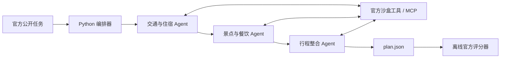

# Travel Planner 多智能体小组项目

基于 ChinaTravel 的旅行规划项目。当前已有交通与住宿、景点与餐饮、行程整合三个角色，使用 MCP 查询官方沙盒，并由独立评分器评估行程。

**小组协作约定：所有人使用同一个仓库的 `main` 主分支，按顺序接力；同一时间只有一位同学提交修改。** 不需要创建功能分支或发起 PR。`main` 是 Git 的默认分支名，即使不分支协作也会存在。

## 1. 第一次加入：获取代码并运行

1. 仓库负责人在 GitHub 的 **Settings → Collaborators → Add people** 中输入同学的 GitHub 用户名，核对账号后发出邀请。同学接受后才能访问私有仓库并上传修改。只有仓库链接不等于获得权限。
2. 在仓库首页点击 **Code → HTTPS**，复制地址。在 VS Code 按 `Ctrl+Shift+P`，选择 **Git: Clone**，粘贴地址并选择保存位置，然后打开克隆出的项目文件夹。不要把项目克隆到现有项目里面。
3. 首次在自己的电脑安装 [Git](https://git-scm.com/downloads)、[VS Code](https://code.visualstudio.com/) 和 [uv](https://docs.astral.sh/uv/getting-started/installation/)。VS Code 建议安装 Microsoft 发布的 Python、Python Debugger 扩展。
4. 在 VS Code 的“终端 → 新建终端”中执行下面的 PowerShell 命令。终端当前目录必须是包含本 README 的项目根目录。

```powershell
git config user.name "你的名字"
git config user.email "你的 GitHub 提交邮箱"
uv python install 3.12
uv sync --frozen
.venv\Scripts\python.exe scripts/bootstrap.py
if (!(Test-Path .env)) { Copy-Item .env.example .env }
.venv\Scripts\python.exe -m lab.cli doctor
.venv\Scripts\python.exe -m lab.cli smoke
.venv\Scripts\python.exe -m pytest -q
```

`git config` 只配置本仓库的提交署名。邮箱可以使用 GitHub **Settings → Emails** 中自己的 noreply 邮箱。署名不等于登录；首次推送若需要登录，请在 Git/VS Code 打开的正规 GitHub 登录流程中自行完成。

下载代码不包括 `.venv`、`.env`、上游代码、完整数据和本地运行日志；这些由安装和 bootstrap 步骤恢复。`uv.lock` 锁定 Python 依赖，`benchmark.lock.json` 锁定官方代码与数据版本，`data/splits.json` 固定小组实验划分。首次恢复需要能访问 GitHub 和 Hugging Face。

`doctor` 不会展示密钥。`smoke` 和 `pytest` 不调用付费模型。只有需要真实模型运行时，才在本地 `.env` 中填写自己的 `DEEPSEEK_API_KEY`；不要把密钥粘贴进 README、Issues 或聊天记录。

macOS/Linux 同学把 `.venv\Scripts\python.exe` 替换为 `.venv/bin/python`，复制配置使用 `cp .env.example .env`（仅在 `.env` 尚不存在时）。现有 VS Code 调试配置以 Windows 为主。

## 2. 每次接手：先确认轮到自己，再更新

先在组内确认上一位已经推送成功、当前由你负责，并阅读 [交接记录](HANDOFF.md) 与 [任务清单](TASKS.md)。同一时间只有当前负责人修改、提交共享项目，避免轮流协作变成同时改同一个版本。

```powershell
git status
git branch --show-current
git pull --ff-only origin main
```

开始时应在 `main`，且 `git status` 显示工作区干净。若有上次未提交的修改，先检查并保存/提交，不要覆盖或删除。`--ff-only` 会在本地与远端历史分叉时停止；遇到失败先和上一位确认，不要使用强制推送或强制重置。

如果上一位更新了依赖，重新执行 `uv sync --frozen`；如果更新了数据恢复流程，按交接说明运行 bootstrap。不要在每次接手时覆盖自己已有的 `.env`。

## 3. 完成修改：测试、提交、上传，再交接

只做当前认领的任务。改完运行与改动相关的检查，至少运行现有测试：

```powershell
.venv\Scripts\python.exe -m pytest -q
# 修改工具、MCP 或评测链路时，额外运行：
.venv\Scripts\python.exe -m lab.cli smoke
```

更新 `TASKS.md` 中该任务的状态；在 `HANDOFF.md` 顶部填写完成内容、测试结果、已知问题和下一步。新增命令、配置或依赖时也更新 README。然后执行：

```powershell
git status
git diff
git add .
git diff --cached --stat
git diff --cached
git commit -m "feat: 简要说明本次完成的内容"
git push origin main
git status
git log -1 --oneline
```

`commit` 只保存到本机；只有 `push` 成功，下一位才能收到修改。上传前检查暂存内容，确认没有密钥、个人数据或不相关文件。`git status` 应显示工作区干净，若配置了上游，还应显示与 `origin/main` 同步。刷新 GitHub 首页，核对最新提交与刚才的 `git log` 一致，再通知下一位接手。

交接消息示例（手动发送到你们的小组群）：

> 本轮任务 T2 已完成并推送到 main，提交：abc1234。测试结果见 HANDOFF.md；下一位请先 pull，再接 T3。已知问题：……

若 `push` 被拒绝，说明远端已有新提交。先联系上一位、检查 `git status`，确认工作区已保存后尝试 `git pull --ff-only origin main`。若提示历史分叉，保留现状一起处理，**不要 `push --force` 或 `reset --hard`**。

VS Code 的界面方式：左侧“源代码管理”查看修改 → 暂存修改 → 输入说明并提交 → 菜单中的 Push。接手时用 Pull。初学阶段分别执行 Pull 和 Push，方便看清每一步是否成功。

## 4. 任务怎么安排

当前的任务顺序与验收标准见 [TASKS.md](TASKS.md)，当前负责人和交接历史见 [HANDOFF.md](HANDOFF.md)。组员姓名、顺序和截止时间由小组填入，尚未替任何同学分配任务。

也可以在 GitHub 的 **Issues → New issue → 小组任务** 建立任务，填写负责人、目标和验收标准。Issues 是任务讨论区，不会自动上传代码；在 TASKS.md 记录对应 Issue 链接，以 TASKS.md 为当前执行顺序。完成并推送后再关闭 Issue。模板已放在 `.github/ISSUE_TEMPLATE/task.md`。

## 5. 当前实现与运行方法

下面保留项目的技术说明。初始整理没有改动 Agent 算法。历史验证记录见 [SETUP_CHECKS.md](SETUP_CHECKS.md)；它记录的是对应日期的结果，不代表每位组员的新环境已经验证通过。

基于官方 ChinaTravel 的可运行入门框架。中文任务、真实官方沙盒、单/多智能体切换、MCP 工具、独立官方评分器。模型配置采用你选择的 `deepseek-chat`。

## 先从这里开始

今天的手把手实践见 [架构说明与 MCP 课程](docs/02-mcp-lab.md)：工具发现、schema、手动查询、错误处理和独立验收。`run` 现在默认通过 MCP 调用工具；`--transport direct` 保留作对照。

在 VS Code 中打开本目录，终端使用 PowerShell。以下命令从项目根目录执行，无需激活环境。

```powershell
.venv\Scripts\python.exe -m lab.cli doctor
.venv\Scripts\python.exe -m lab.cli inspect
.venv\Scripts\python.exe -m lab.cli smoke
.venv\Scripts\python.exe -m pytest -q
```

`smoke` 不使用模型、不收费：加载真实任务，调用 Python 和 MCP 两条工具链，再确认官方评分器会拒绝无效行程。它不是 Agent 的成功率实验。

## 接入 DeepSeek

从 `.env.example` 创建本地 `.env` 后，在 VS Code 中填入 `DEEPSEEK_API_KEY`。不要把密钥放进代码、聊天或 Git。

```dotenv
DEEPSEEK_API_KEY=在本地填写
DEEPSEEK_BASE_URL=https://api.deepseek.com
DEEPSEEK_MODEL=deepseek-chat
```

保留用户指定的模型名。当前账号是否仍支持该模型/别名，需要真实连接后确认；如果返回 model not found，在 `.env` 修改为账号支持的模型 ID。不会自动换模型，避免影响实验。

然后先运行一条开发任务（会产生服务商 API 费用）：

```powershell
.venv\Scripts\python.exe -m lab.cli run --mode single --transport mcp --limit 1
.venv\Scripts\python.exe -m lab.cli run --mode multi --transport mcp --limit 1
```

输出目录形如 `runs/日期时间-multi/`，命令结束时会打印准确路径。使用该路径评分：

```powershell
.venv\Scripts\python.exe -m lab.evaluate "runs/实际运行目录"
```

VS Code 的“运行和调试”也提供查看任务、自检、单智能体、多智能体四个入口；如未安装 Python/Debugger 扩展，可以直接使用终端命令。

## 框架如何工作



三角色目前顺序执行，便于逐步调试。角色有独立提示词和工具范围，通过显式任务、候选和原始工具证据交接；最终规划角色协调全局预算与时间。暂未实现自治群聊、长期记忆、自动重规划和并行调度。

- `lab/cli.py`：命令入口和运行记录。
- `lab/workflow.py`：角色分工、提示词、交接数据；推荐从这里阅读。
- `lab/agent.py`：手写工具调用循环、模型调用、统一计数与日志。
- `lab/tools.py`：同一批官方工具的 direct/MCP 两种调用路径。
- `lab/mcp_server.py`：使用官方 MCP Python SDK 包装沙盒。
- `lab/benchmark.py`：只加载 Agent 可见的任务文本。
- `lab/evaluate.py`：独立加载隐藏标注，调用官方逐任务评分函数。
- `scripts/bootstrap.py`：下载固定版本官方代码与数据，记录哈希。
- `vendor/ChinaTravel/`：官方代码，尽量保持原样。
- `data/public/`：Agent 可见任务；`data/private/`：仅离线评分使用的标注。

## 已加载的 benchmark 范围

加载中文沙盒以及 `easy`、`medium`、`human` 三个官方任务 split。实际数量、源码 commit、数据 revision 和 SHA256 均记录在 `data/manifest.json`。

为了学习，`data/splits.json` 固定使用 easy 的前 10 条作开发集，随后 20 条作本地 holdout。它们不是官方排行榜划分，规模也不足以支持普遍结论。正式实验前应确定有代表性的划分、检查近似任务泄漏并冻结。

```powershell
.venv\Scripts\python.exe -m lab.cli run --mode multi --subset holdout --limit 20
# 非 easy split 需显式选 all：
.venv\Scripts\python.exe -m lab.cli inspect --split human --limit 1
```

Agent 输入仅包含 UID 与自然语言请求，工具层不暴露其他任务加载、隐藏约束或任意命令执行。评分器不参与规划或迭代反馈。此隔离是代码接口边界，并非进程/文件系统级安全隔离。

## 评测与预算

当前评分包括官方 schema、commonsense、hard-constraint 和三者联合通过情况；偏好指标留作后续接入。缺失输出算失败，评测异常应修复后再报告结果。结果仅适用于所选数据版本与任务子集。

每条任务统一最多 24 次模型调用和 60 次工具调用。多智能体分配为研究 6+6、规划 12；单智能体最多 24 次。记录输入/输出 tokens、模型实际返回的型号、工具次数与墙钟时间。100000 token 阈值按服务端已返回的 usage 检查，某次请求的输入可能使累计值越界，不能当作严格账单上限。API 超时 120 秒、SDK 不自动重试；没有后台模型调用。

比较 single/multi 时使用同一模型、工具传输方式、任务列表和总预算。MCP 的进程启动时间计入端到端延迟；是否并行、是否使用额外核验也要记录。

## 新机器恢复

```powershell
uv python install 3.12
uv sync --frozen
.venv\Scripts\python.exe scripts/bootstrap.py
if (!(Test-Path .env)) { Copy-Item .env.example .env }
```

首次下载需要 GitHub 与 Hugging Face 网络。已保存的数据可离线调用与评分。`uv.lock` 锁定依赖；`benchmark.lock.json` 锁定源码 commit、数据 revision 和下载文件哈希。下载脚本校验已保存文件，不会删除你修改过的官方源码。

## 下一次手把手学习

1. 打开 `data/public/easy.json` 的第一条任务，解释输入和要求。
2. 在 `lab/workflow.py` 的 `solve()` 设断点，观察三个角色收到的信息。
3. 运行一条真实 single，再运行同一条 multi，查看各自的 `trace.jsonl`。
4. 用离线评分器定位失败，再决定要改工具使用、上下文还是任务分工。

上游：[ChinaTravel](https://github.com/LAMDA-NeSy/ChinaTravel) · [数据](https://huggingface.co/datasets/LAMDA-NeSy/ChinaTravel) · [沙盒](https://huggingface.co/datasets/LAMDA-NeSy/ChinaTravel-Sandbox)。官方代码/文档 MIT，官方数据 CC BY 4.0。请在研究报告中引用 ChinaTravel 论文。
